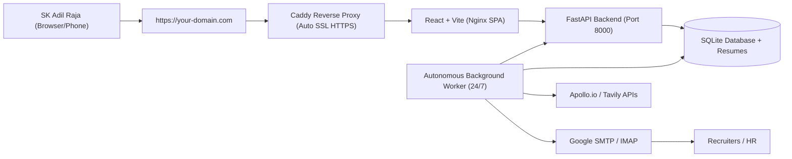

# 🚀 CareerPilot AI: 24/7 Cloud Deployment & Custom Domain Guide

This guide walks you through deploying **CareerPilot AI v2.0** on a cloud server so it runs **24/7 autonomously** in the background. You do **not** need to keep your laptop open or running; the cloud server will handle job scraping, Apollo contact discovery, email dispatches, and follow-ups. You can simply open your browser or phone, visit your custom domain, and check on everything.

---

## 🏗️ Architecture Overview



---

## 🌟 Step 1: Choose a Cloud Host (Virtual Private Server)

Any inexpensive Linux VPS running Ubuntu 22.04 or 24.04 will run this 24/7 with zero maintenance.

| Provider | Recommended Plan | Price | Notes |
| :--- | :--- | :--- | :--- |
| **DigitalOcean** (Recommended) | Basic Droplet (1 GB RAM, 1 vCPU, 25 GB SSD) | ~$4 - $6 / mo | Easiest setup, clean interface |
| **Hetzner Cloud** | CX22 (4 GB RAM, 2 vCPU) | ~€3.79 / mo | Best performance per dollar |
| **AWS Lightsail** | 1 GB RAM, 1 vCPU instance | ~$3.50 / mo | Very reliable, 1-click snapshot backups |
| **Linode / Akamai** | Nanode 1GB | ~$5 / mo | Simple, fast worldwide network |

---

## 🌐 Step 2: Configure Your Domain DNS Records

Log in to where you purchased your domain (GoDaddy, Namecheap, Hostinger, Google Domains/Squarespace, Cloudflare):

1. Go to **DNS Management** / **DNS Records**.
2. Add an **A Record**:
   * **Type**: `A`
   * **Host / Name**: `@` (or a subdomain like `pilot` or `jobs` if you prefer `jobs.yourdomain.com`)
   * **Points to / Value**: `Your Cloud Server IP Address` (e.g. `165.22.120.45`)
   * **TTL**: `Automatic` or `300 seconds`
3. *(Optional)* Add a `www` record:
   * **Type**: `CNAME`
   * **Host / Name**: `www`
   * **Value**: `@`

---

## ⚡ Step 3: Deploy to Your Cloud Server (3 Commands)

Connect to your server via SSH:
```bash
ssh root@YOUR_SERVER_IP
```

### 1. Install Docker & Docker Compose
```bash
curl -fsSL https://get.docker.com -o get-docker.sh && sh get-docker.sh
```

### 2. Clone or Copy CareerPilot AI to the Server
```bash
git clone <YOUR_GIT_REPO_URL> careerpilot-ai
cd careerpilot-ai
```
*(Or transfer your local directory using `rsync -avz ./ root@YOUR_SERVER_IP:/root/careerpilot-ai`)*

### 3. Configure Your Domain & API Keys in `.env`
Edit `backend/.env` with your real keys:
```bash
cp backend/.env.example backend/.env
nano backend/.env
```
Ensure your live credentials are set:
```ini
DOMAIN_NAME=yourdomain.com
APOLLO_API_KEY=xUZFr72ERmXWos7Cuc_JIQ
TAVILY_API_KEY=tvly-dev-...
SMTP_USERNAME=adilrazask@gmail.com
SMTP_PASSWORD=your_gmail_app_password
EMAIL_FROM=adilrazask@gmail.com
```

### 4. Launch the 24/7 Container Stack
```bash
export DOMAIN_NAME=yourdomain.com
docker compose up -d --build
```

**That's it!**
* Caddy automatically provisions a **free SSL certificate** (HTTPS) from Let's Encrypt for `https://yourdomain.com`.
* The **FastAPI Backend**, **React Frontend**, and **Autonomous Background Worker** are running 24/7 in background containers.
* The system automatically restarts on server reboots (`restart: unless-stopped`).

---

## 🕒 How the Autonomous Rules Work on the Cloud Server

1. **Strict Business Hours Window (10:00 AM – 6:00 PM IST)**:
   * Even though the cloud server is awake 24/7, **no emails will be sent before 10:00 AM or after 6:00 PM IST**.
   * Outside this window, scheduled emails and follow-ups are safely queued and hold until 10:00 AM the next morning.
   * Job enrichment and Apollo contact search continue running in the background.
2. **Daily Limit of 10 Emails**:
   * Outbound applications are capped at a maximum of **10 per day**.
   * Company deduplication ensures **no company is ever contacted twice**.
3. **Exact Resume PDF Attachment**:
   * Uses only your original uploaded file `SK_Adil_Raja_Resume.pdf`.

---

## 📱 How You Monitor It from Anywhere

1. Open your phone or laptop browser.
2. Go to **`https://yourdomain.com`**.
3. Click **"Sign in with Google"** or log in as **SK Adil Raja (Super Admin)**.
4. From the **Command Centre**:
   * Monitor live applications, responses, and interviews.
   * View live user sessions and terminate unauthorized access with one click.
   * Use **"One-Click Apply"** to manually fire prepared batches whenever you want.
